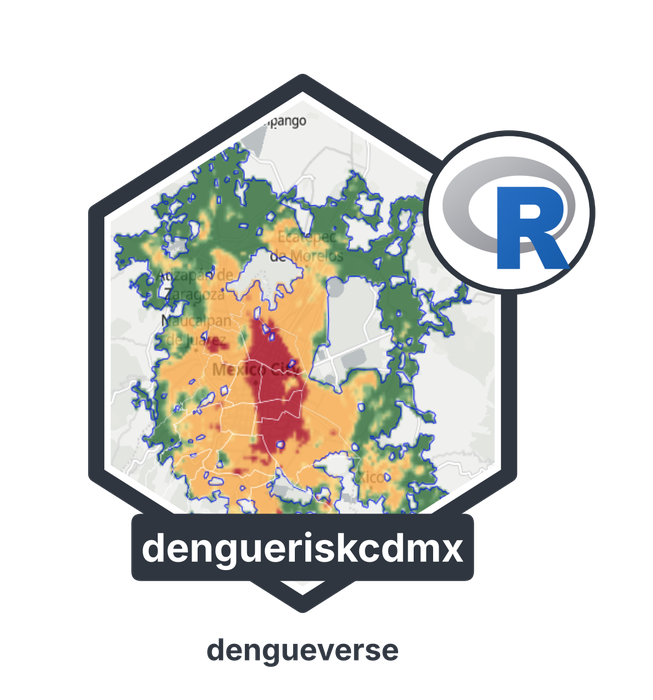

# dengueriskcdmx 

<!-- badges: start -->
[](https://fdzul.r-universe.dev/dengueriskcdmx)
[](LICENSE.md)
[](https://lifecycle.r-lib.org/articles/stages.html#experimental)
[](https://github.com/fdzul/dengueriskcdmx-py)
[](https://fdzul.github.io/dengueriskcdmx/)
<!-- badges: end -->

Data, rasters and code for supporting the **Risk Map of Dengue Transmission in the Metropolitan Area of Mexico City**.

## Installation

```r
# install.packages("remotes")
remotes::install_github("fdzul/dengueriskcdmx")
```

## What is included

| Object | Description |
|---|---|
| `ae_aegypti_2017_2024` | *Ae. aegypti* ovitrap presences and pseudo-absences, 2017-2024, with the `split` column (train / test) |
| `ae_aegypti_2017_2024_train` | Training partition (80%) |
| `ae_aegypti_2017_2024_test` | Test partition (20%) |
| `ae_aegypti_2025` | External validation data, 2025 |
| `aoi` | Study area (Mexico City Metropolitan Area) |

Each data set has the class (`presence` / `pseudoabs`), nine predictors (`built`, `tree`, `ndvi`, `prcp`, `ia`, `ice`, `im`, `pop`, `hfp`) and the point geometry. The partition is 80/20, stratified by class, with seed 12345.

The Quarto code of the machine-learning workflow (`ml_code_ae_aegypti.qmd` and `ml_code_dengue.qmd`) is provided as vignettes.

Three rasters (about 500 m) are shipped in `inst/extdata`, all derived from the consensus (mean of the probabilities) of Random Forest, LightGBM and XGBoost models:

| `layer` | Raster |
|---|---|
| `"aedes"` | Probability of *Ae. aegypti* occurrence |
| `"dengue"` | Probability of confirmed imported dengue cases |
| `"risk"` | Five-level epidemiological risk |

## Example

```r
library(dengueriskcdmx)

# ovitrap data
table(ae_aegypti_2017_2024$class)

# rasters (requires the terra package)
r <- ae_raster("aedes")
terra::plot(r)
```

## Data availability

The ovitrap data are included. The data on confirmed dengue cases used to fit the case model are **not** published; only the derived probability and risk rasters are provided.

## Dashboard

An interactive version of the maps is available at <https://eclectic-alfajores-088839.netlify.app/>.

## Citation

Dzul-Manzanilla F, Correa-Morales F. Risk Map of Dengue Transmission in the Metropolitan Area of Mexico City (under review).

## License

MIT
